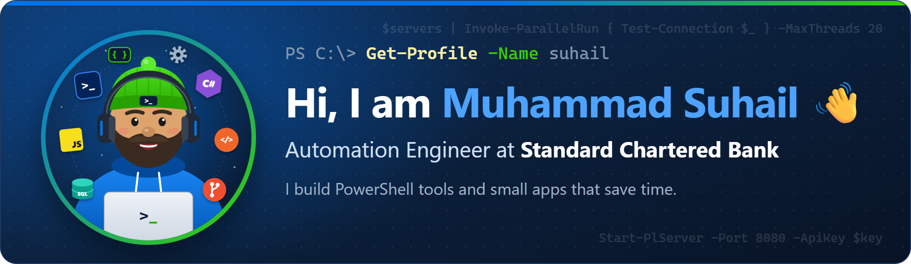
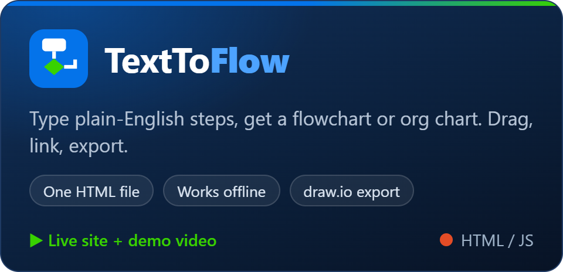
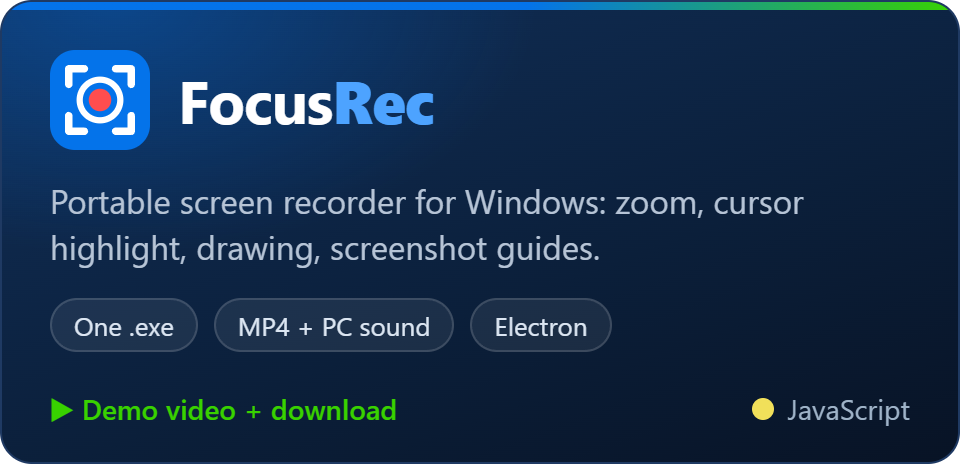
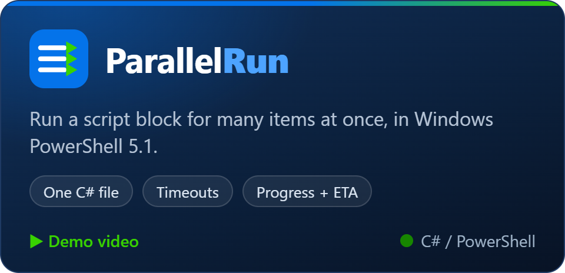
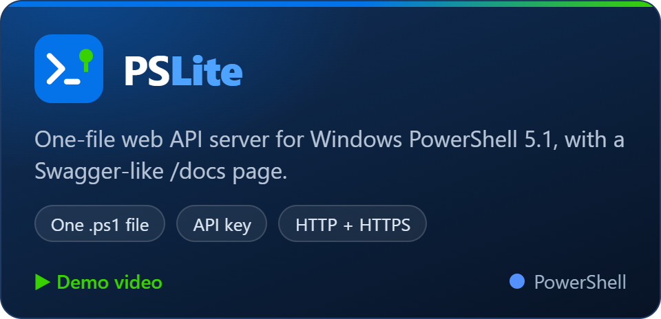

  

### About me

- 🔧 **Automation Engineer** at **Standard Chartered Bank**
- ⚡ I automate IT work with **PowerShell**, and build the small tools around it in C#, JavaScript and SQL
- 🧰 I like tools that are **one file** and **need nothing installed**
- 📫 Reach me at **[suhail.asrul@gmail.com](mailto:suhail.asrul@gmail.com)**

### Projects

<table>
  <tr>
    <td width="50%" valign="top">
      
      
<a href="https://suhailasrulsani-git.github.io/texttoflow/">Open it</a> · <a href="https://suhailasrulsani-git.github.io/texttoflow/TextToFlow-demo.mp4">Demo video</a> · <a href="https://github.com/suhailasrulsani-git/texttoflow">Code</a>

    </td>
    <td width="50%" valign="top">
      
      
<a href="https://github.com/suhailasrulsani-git/focusrec/releases/latest">Download</a> · <a href="https://github.com/suhailasrulsani-git/focusrec/releases/download/v0.2.0/FocusRec-demo.mp4">Demo video</a> · <a href="https://github.com/suhailasrulsani-git/focusrec">Code</a>

    </td>
  </tr>
  <tr>
    <td width="50%" valign="top">
      
      
<a href="https://suhailasrulsani-git.github.io/parallelrun/ParallelRun-demo.mp4">Demo video</a> · <a href="https://github.com/suhailasrulsani-git/parallelrun">Code</a>

    </td>
    <td width="50%" valign="top">
      
      
<a href="https://suhailasrulsani-git.github.io/pslite/PSLite-demo.mp4">Demo video</a> · <a href="https://github.com/suhailasrulsani-git/pslite">Code</a>

    </td>
  </tr>
</table>

### Tech I use

  
  
  
  
  
  
  
  

  
  
  
  
  

### GitHub stats

  
  

  

### Contact

  
  

